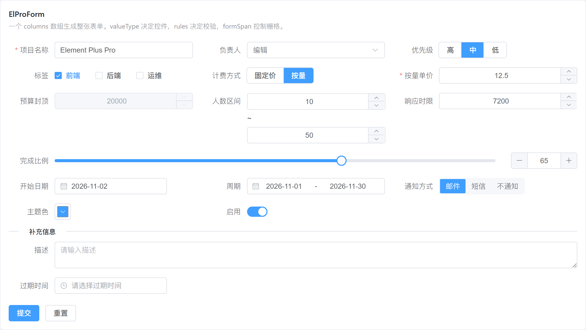
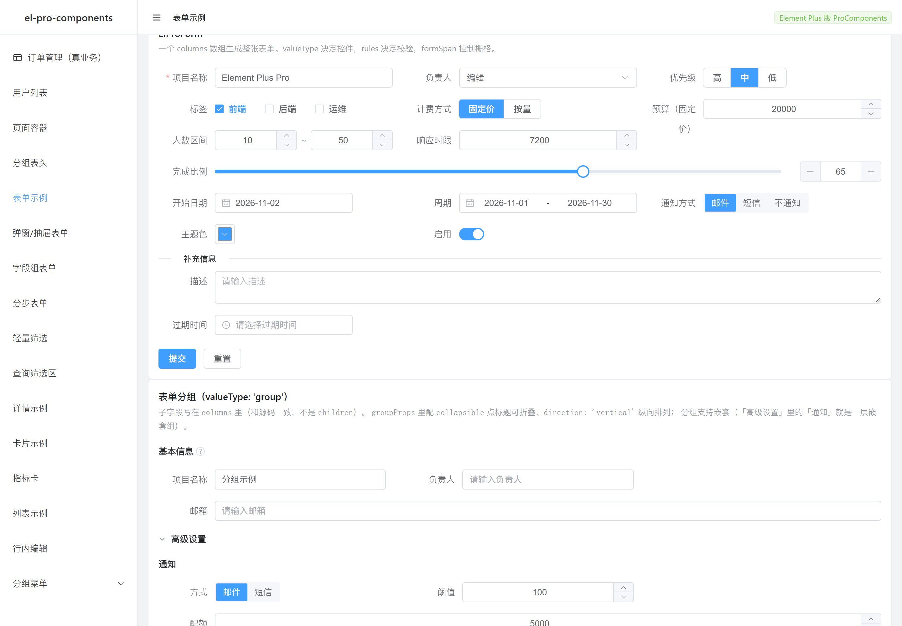
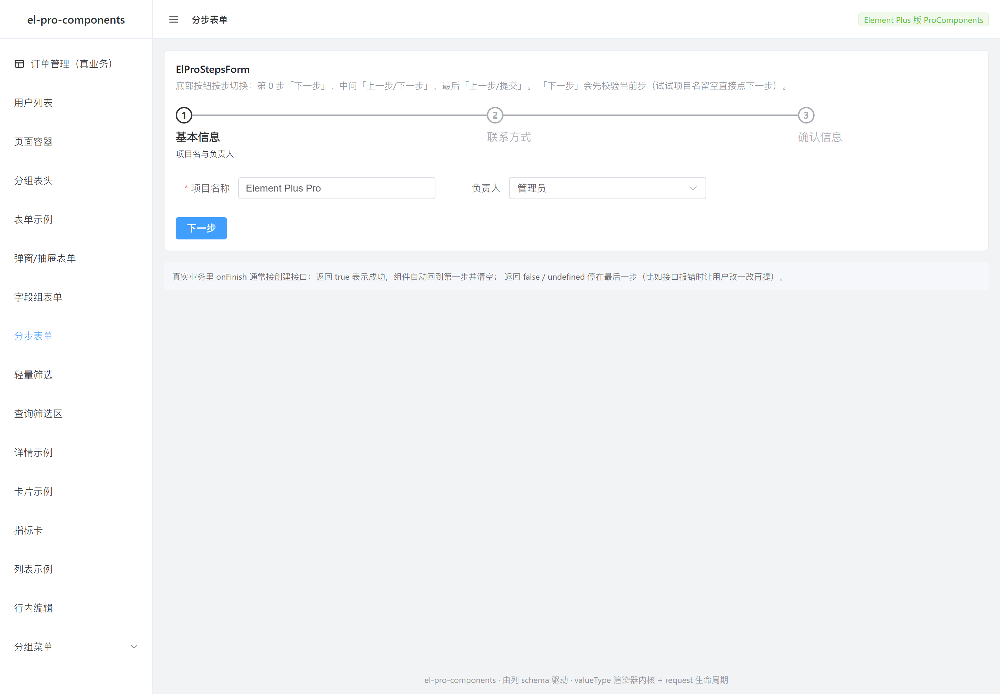
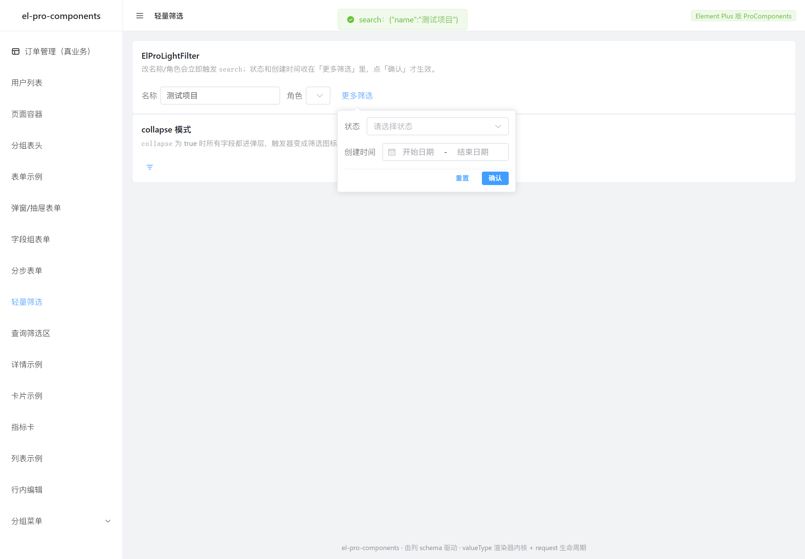
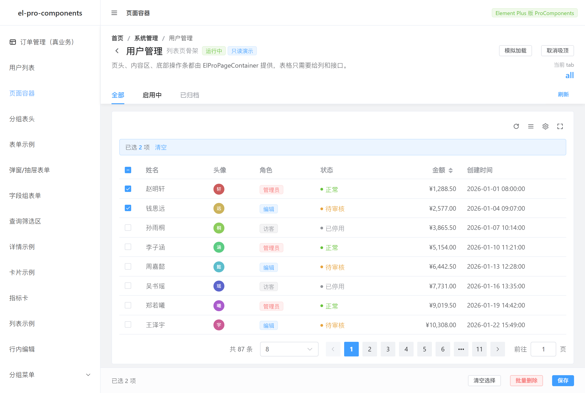
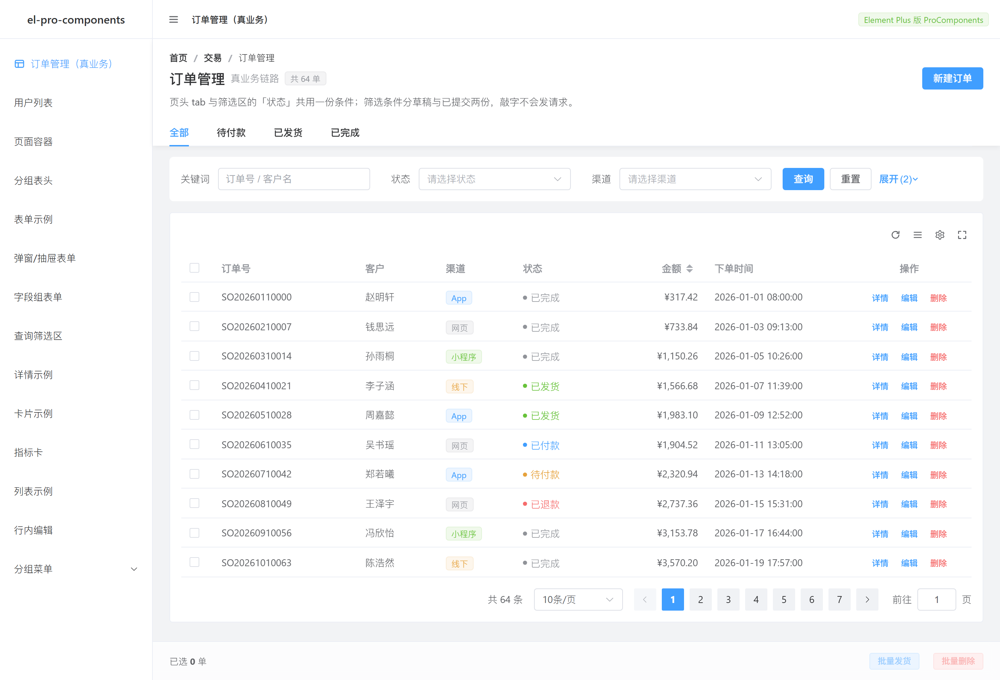

# el-pro-components

Element Plus 体系的 CRUD 高阶组件：**由一份 columns 定义，同时驱动搜索栏、表格列、列设置面板、表单和详情页。**


## 为什么做这个

Element Plus 提供了很好的基础组件，但没有 CRUD 页面的「模板层」。真实项目里每写一个列表页，都要重复做一遍：

- 搜索表单 → 拼参数 → 请求 → 分页 → 排序 → 再请求
- 列的显示/隐藏、密度、刷新按钮
- 表格里把 `status: 1` 翻译成「正常」并染色
- 同一个字段在表格里显示 tag、在详情页里显示同样的 tag、在表单里是下拉

Ant Design 生态用 ProComponents 解决了这个问题，但那是 React 的。Vue 3 + Element Plus 这边没有同量级的对标物。

这个库把那套抽象搬过来，并**按 Element Plus 的习惯重新设计 API**。

## 安装

```bash
npm i el-pro-components
```

```ts
import { createApp } from 'vue'
import ElementPlus from 'element-plus'
import 'element-plus/dist/index.css'
import ElProComponents from 'el-pro-components'
import 'el-pro-components/style.css'

createApp(App).use(ElementPlus).use(ElProComponents).mount('#app')
```

`vue` 和 `element-plus` 是 peerDependencies，不会被打进包里。

## 快速开始

```vue
<script setup lang="ts">
import { ElProTable } from 'el-pro-components'
import type { ProColumn, ProRequest } from 'el-pro-components'

const columns: ProColumn[] = [
  { prop: 'id', label: 'ID', valueType: 'indexBorder', width: 64, search: false },
  { prop: 'name', label: '姓名', copyable: true },
  { prop: 'role', label: '角色', valueType: 'tag', valueEnum: ROLE_ENUM },
  { prop: 'status', label: '状态', valueType: 'status', valueEnum: STATUS_ENUM },
  { prop: 'amount', label: '金额', valueType: 'money', sortable: 'custom', search: false },
  { prop: 'createdAt', label: '创建时间', valueType: 'dateTime', sortable: 'custom' },
  { prop: 'actions', label: '操作', valueType: 'option', fixed: 'right' },
]

const request: ProRequest<User> = async (params, sort, { signal }) => {
  const res = await api.list(params, { signal })
  return { data: res.rows, total: res.total }
}
</script>

<template>
  <ElProTable :columns="columns" :request="request" row-key="id" title="用户列表" selection>
    <template #actions="{ row }">
      <ElButton link type="primary" @click="edit(row)">编辑</ElButton>
    </template>
  </ElProTable>
</template>
```

**就这样。** 搜索栏、分页、排序、列设置、刷新、密度切换、全屏全部自动出现。

## request 的约定

```ts
type ProRequest<T> = (
  params: { current: number; pageSize: number; [key: string]: any },
  sort: Record<string, 'asc' | 'desc'>,
  extra: { signal: AbortSignal },
) => Promise<{ data: T[]; total?: number; success?: boolean }> | T[]
```

三个要点：

1. **`params` 的合并顺序**：搜索表单值 → `params` prop → 分页信息。`params` 优先级高于搜索表单，适合放路由参数这类外部条件。
2. **`sort` 是 `{ 字段: 'asc' | 'desc' }`**，不是 antd 的 `'ascend' | 'descend'`。只有配置了 `sortable="custom"` 的列才会进这里。
3. **竞态已处理**。内部用自增序号丢弃过期响应，所以连续快速切页不会出现数据串页；同时会把 `AbortController.signal` 给你，接进 axios/fetch 就能真正取消请求、省带宽。

后端参数名不一样时，用 `paramsAdapter` 转换，不用改内部约定：

```vue
<ElProTable
  :params-adapter="(p) => ({ pageNum: p.current, limit: p.pageSize, ...p })"
  ...
/>
```

## 组件

| 组件 | 一句话 |
| --- | --- |
| `ElProTable` | 列配置驱动的 CRUD 表格（搜索栏 / 列设置 / 分页 / 排序 / 竞态） |
| `ElProEditableTable` | 上面那个把「行内编辑」预置好的薄壳 |
| `ElProQueryFilter` | 独立成块的查询筛选区（默认折叠，条件是页面自己的） |
| `ElProForm` | 同一份 columns 生成表单（含分组 / 字段组 / 联动） |
| `ElProStepsForm` | 分步表单：每步校验过了才前进，最后一步统一 onFinish |
| `ElProLightFilter` | 轻量筛选：行内紧凑字段，secondary 项收进「更多筛选」弹层 |
| `ElProModalForm` / `ElProDrawerForm` | 同一套表单放进弹窗 / 抽屉，提交成功才关窗 |
| `ElProDescriptions` | 同一份 columns 生成详情页 |
| `ElProLayout` | 侧边菜单 + 面包屑外壳 |
| `ElProPageContainer` | 页面容器：页头（可吸顶）+ 内容区（可限宽）+ 底部固定操作条 |
| `ElProPageHeader` / `ElProFooterToolbar` | 上面那个拆开的两块，也可以单独用 |
| `ElProCard` | 结构化头部 + 折叠 + 嵌套分组 + 标签页 |
| `ElProStatistic` / `ElProStatisticCard` / `ElProStatisticCardGroup` | 指标卡：数值 + 趋势 + 图表位，几张拼一条 |
| `ElProCheckCard` / `ElProCheckCardGroup` | 整块可点的卡片，做单选/多选 |
| `ElProList` | 同一份 columns 生成列表页 / 卡片流 |
| `ElProSkeleton` | 列表 / 表格 / 详情 / 结果页四种版式的骨架屏 |

### ElProTable

| 属性 | 说明 |
| --- | --- |
| `columns` | 列定义，必填 |
| `request` | 数据请求函数 |
| `params` | 额外查询参数，变化自动重查 |
| `search` | 是否显示搜索栏，默认 `true` |
| `options` | 工具栏图标开关 `{ reload, density, setting, fullscreen }`，传 `false` 全关 |
| `selection` | 是否显示多选列 |
| `pagination` | 分页配置，传 `false` 关闭 |
| `persistenceKey` | 传了就把列显隐 / 顺序 / 固定持久化到 localStorage |
| `columnOrder` | 受控列顺序（prop 数组），配合 `v-model:column-order` |
| `columnFixed` | 受控固定列（`{ prop: 'left' \| 'right' }`），配合 `v-model:column-fixed` |
| `paramsAdapter` | 后端参数名转换 |

插槽：`#toolbar`（标题区）、`#toolbarActions`（右侧按钮）、`#batch`（批量操作）、`#empty`、`#${列的 prop}`（列自定义渲染），以及**默认插槽**（往表格里插任意 `el-table-column`）。

事件与方法：

| 名称 | 说明 |
| --- | --- |
| `@load(data)` | 每次加载完成。此时 `getTotal()` 已经写好，可以直接读 |
| `@loading-change(boolean)` | 加载态变化。**页面要让别的组件跟着转圈（筛选按钮、页头刷新）就靠它** |
| `@selection-change(rows)` | 勾选变化。`row-key` + `selection` 时自动开 `reserve-selection`，跨页勾选会累计 |
| `@error(err)` | 请求失败 |
| `reload(resetPage?)` / `reloadAndRest()` / `reset()` | 重查 / 回第一页重查 / 连搜索条件一起重置 |
| `setPage({ current, pageSize })` | 改页码 |
| `clearSelected()` | 清空勾选（同时清掉跨页保留的那部分） |
| `getData()` / `getSelected()` / `getTotal()` / `getPage()` | 读当前状态，导出、页头统计、删空回退都要用 |

#### 多级表头

`columns` 里写 `children` 就是分组表头，可以继续嵌套：

```ts
const columns: ProColumn<User>[] = [
  { label: '基础信息', children: [
    { prop: 'name', label: '姓名' },
    { prop: 'email', label: '邮箱' },
  ]},
  { label: '业绩', children: [
    { prop: 'score', label: '评分', valueType: 'rate' },
    { prop: 'amount', label: '金额', valueType: 'money', sortable: 'custom' },
  ]},
  { prop: 'status', label: '状态', valueType: 'status', valueEnum: STATUS_ENUM },
]
```

三条约定：

- **分组列不写 `prop`**：它不产生单元格，只是表头容器。写了也不会用上。
- **显隐状态挂在叶子列上**：列设置面板里，组是一行「全选开关」，下面缩进列子列；子列全隐藏时整组一起消失，不会留个空表头。
- **有分组时关闭拖拽、子列不给固定按钮**：顺序存的是扁平 prop 数组，表达不了「换到另一个组里去」；`el-table` 固定的也只是顶层列。与其点了没反应，不如不给。


#### 默认插槽：插 schema 表达不了的列

`columns` 只描述「有 prop 的字段」。展开行、勾选列这类结构性列用默认插槽插，位置在 schema 列**之前**：

```vue
<ElProTable :columns="columns" :request="request">
  <ElTableColumn type="expand" width="40">
    <template #default="{ row }">{{ row.desc }}</template>
  </ElTableColumn>
</ElProTable>
```

操作列不要走这个插槽 —— 用 `{ valueType: 'option' }` 的列（自动 `fixed: 'right'`），它必须排在最后，否则 sticky offset 会算错。

#### 列配置

工具栏的列设置面板（右上角齿轮）做了四件事，状态都跟着 `persistenceKey` 落 localStorage：

| 能力 | 说明 |
| --- | --- |
| 显示 / 隐藏 | 勾选框；`index` / `option` 列和 `hideInSetting` 的列不进面板，避免把自己锁死。有多级表头时按「组 → 子列」展开，组上的勾选框是整组全选 |
| 拖拽排序 | 原生 HTML5 拖拽，不引 sortablejs；只重排可设置列，索引列/操作列原地不动。**有分组列时整个关闭**（见多级表头那节） |
| **固定列首 / 列尾** | 每行右侧两个钉住图标，再点一次同一侧即取消。分组下的子列没有这个按钮 |
| 重置 | 显隐、顺序、固定一起回到 `columns` 的原始定义 |

固定列会**连带重排顺序**：el-table 的 `fixed` 是 sticky + 逐列累加 offset，固定列夹在普通列中间会被盖住。所以按「左固定 → 普通 → 右固定」重排，组内保持原相对顺序（`sortPropsByFixed`），并把新顺序写回 `order`。

面板本体是 `ElProTable/ColumnSetting.vue`，它**只上报用户意图**（勾选 / 拖到哪 / 固定到哪），
三份状态都归 `ElProTable` 所有 —— 面板自己拼新状态会踩 props 快照的坑（同一 tick 连点两次，第二次覆盖第一次）。


通过 ref 拿到的实例方法：

```ts
tableRef.value.reload()          // 刷新，保持当前页
tableRef.value.reloadAndRest()   // 刷新并回到第一页、清空选中
tableRef.value.reset()           // 重置搜索条件 + 排序 + 页码
tableRef.value.clearSelected()
tableRef.value.setPage({ current: 3 })
tableRef.value.getData()         // 当前页数据，可用于导出
```

#### 列宽：`width` 是下限，不是死宽

表格总是撑满容器，`width` 只是**下限**（内部传给 el-table 的是 `min-width`），
容器比所有列加起来还宽时，多出来的宽度按比例摊给各列 —— 和 antd `table-layout: auto` 一个表现。

```ts
const columns: ProColumn[] = [
  { prop: 'orderNo', label: '订单号', width: 168 },   // 容器宽时会长到 ~200
  { prop: 'amount', label: '金额', width: 128 },
  { prop: 'icon', label: '', width: 40, flex: false }, // flex: false → 钉死 40
]
```

要钉死某列（图标列、状态点这类）就加 `flex: false`，它走原生 `width`，不参与分配。

> 为什么必须这么干：el-table 只在**存在没有 `width` 的列**时才分配剩余宽度
> （`if (flexColumns.length > 0 && fit)`）。schema 里每列都写了 `width` 时它一步都不动，
> 表格停在 Σwidth，右边留一条空白。这不是 el-table 的 bug，是它的语义和 antd 不一样；
> 所以适配层把 `width` 当 `min-width` 传，把这个差异抹平。

#### 行内编辑

给 `editable` 就进入编辑态；`ElProEditableTable` 只是把默认值收好的薄壳：

```vue
<ElProTable
  :columns="columns"
  :request="request"
  :editable="{
    type: 'single',                 // single：切换行会先保存当前行；multiple：可同时编辑多行
    onSave: (key, row) => api.save(key, row),
    onDelete: (key) => api.remove(key),
  }"
/>
```

- 单元格用哪个控件由 `valueType` 决定（`money` → 数字框、`role` → 下拉），和表单是同一套渲染器。
- `column.editable` 控制哪一列可编辑：不写按 `valueType` 推断（`index` / `option` / `progress` / `image` 之类不进编辑态），也可以传函数按行决定。
- **保存失败不会丢输入**：`onSave` 返回 `false` 或抛错时，该行留在编辑态、数据不写回。
- 保存前只改草稿，`data` 里的原对象不动 —— 这样「取消」才有意义。
- **新增行拿主键**：`onSave` 可以返回保存后的记录（接口回包），返回的对象会合并进该行。返回了主键，这一行才会摆脱内部临时 key（`__new_n`），之后编辑、删除才能拿真实 id 调接口。
- 新增行没有 id 时用内部临时 key 区分编辑态；临时 key 存在行对象的 `Symbol` 属性上，不会出现在 `JSON.stringify` 或发出去的请求体里。

### ElProQueryFilter

```vue
<ElProQueryFilter :columns="columns" :model="model" @search="onSearch" @reset="onReset" />
```

和 `ElProTable` 内置那个搜索栏长得像，差别只在**谁管状态**：内置搜索栏是表格的一部分，值收在表格内部；
这个是独立组件，`model` 在页面手里。所以同一份筛选条件能同时喂给请求、导出、右上角的条件回显。


折叠是默认行为，露几项不是写死的，而是**按一行能放几项减一**算出来的（留一格给按钮）。
一行几项又跟着断点和 `span` 走，所以窄屏会自动少露几项——这也是为什么 `span` 一改，折叠数量跟着变。

| 属性 | 说明 |
| --- | --- |
| `columns` | 同表格的列定义。`hideInSearch` 的列不进来；`search.valueType` 可以换成另一种控件（比如表格显示 `dateTime`、这里选区间） |
| `model` | 受控数据。不传则组件内部建草稿 |
| `initialValues` | 初始值。**同时是「重置」要回到的基准**；不传就取挂载时 `model` 的快照 |
| `span` | 每项占几格，支持响应式 `{ xs: 24, lg: 6 }`，默认 `{ xs: 24, sm: 12, md: 8, lg: 6 }` |
| `defaultFormItemsNumber` | 折叠时露几项，覆盖按 span 推算的值 |
| `defaultCollapsed` / `collapsed` | 默认折叠；`collapsed` 是受控开关，配 `v-model:collapsed` |
| `searchText` / `resetText` / `loading` | 按钮文案与查询按钮的 loading |
| `labelWidth` / `labelPosition` / `gutter` / `split` | 透传给内部 `el-form`。`split` 只在 `labelPosition: 'top'` 时画行间分割线 |

事件：`@search(values)`、`@reset(values)`、`@collapse-change`。实例方法：`search()`、`reset()`、`getValues()`、`validate()`、`collapse()`、`expand()`。

两个实现细节值得知道：

- **交出去的是快照**（`{ ...model }` 的浅拷贝）。查询之后再改表单，外面收到的那份不会跟着变——否则你把它塞进 `request` 的依赖里，会自己触发一轮没人点的请求。
- **操作列用 `offset` 贴右边**，不是 flex 推过去。推过去的写法在换行时会飘到下一行左边，`offset` 是按栅格算出来的位置。

### ElProForm

```vue
<ElProForm :columns="columns" :model="model" :span="8" label-width="90px" @submit="onSubmit" />
```

`model` 需要传**响应式对象**（`reactive`），组件直接读写它的字段——和 `el-form` 的约定一致。

`rules`、`formItemProps` 直接透传给 `el-form-item`；`fieldProps` 透传给输入控件。
`valueType: 'divider'` 可以插分组标题。

实例方法：`validate()`、`reset()`、`clearValidate()`、`submit()`。

#### 字段组（formList）

`valueType: 'formList'` 把一列变成「可增删的对象数组」，`children` 是每一项里的字段：

```ts
{
  prop: 'contacts',
  label: '联系人',
  valueType: 'formList',
  formSpan: 24,
  // 组自己也要校验时，记得写 type: 'array'，否则 async-validator 不会按键长判空
  rules: [{ required: true, type: 'array', message: '至少需要一位联系人' }],
  children: [
    { prop: 'name', label: '姓名', valueType: 'text', formSpan: 8, rules: [{ required: true, message: '请输入姓名' }] },
    { prop: 'phone', label: '电话', valueType: 'text', formSpan: 8 },
  ],
  formListProps: { min: 1, max: 3, copyable: true, addText: '添加联系人' },
}
```

**校验是怎么跑的**：每一项里的 `el-form-item` 都还挂在**根表单**上（逐层 inject 到的都是同一个 `el-form`），
`prop` 写成带下标的路径 `contacts.0.name`。所以 `ElProForm.validate()` 天然会连嵌套项一起校验，
不需要把子规则收集起来再聚合——这也是为什么 `validate()` 的返回值在字段组场景下依然可信。

| `formListProps` | 说明 |
| --- | --- |
| `min` | 最少几项。初始不足会**自动补齐**，等于这个数时删除按钮禁用。默认 `0` |
| `max` | 最多几项，达到后添加按钮禁用。默认不限 |
| `copyable` | 每项可复制（插在原项后面） |
| `creator` | 新增一项的初值工厂，不传就是 `{}` |
| `itemTitle` | 每项标题，默认「第 N 项」 |
| `span` / `gutter` | 每项内部字段的默认栅格与间距 |

有一个坑值得先说：**下标会随增删漂移**。所以行的 `v-for` key 用的是 Symbol（跟着 `JSON.stringify` 一起被忽略，不会混进提交数据），
删掉中间一项后剩下的输入框不会跟错行。如果你给 `creator` 传了对象，也别在里面放 `__key` 之类的字段名——用不到，而且会提交上去。


#### 字段联动（dependency）

一列跟着别的字段变——显不显示、标题换不换、要不要禁用、选项换一套：

```ts
{
  prop: 'customRate',
  label: '按量单价',
  valueType: 'money',
  rules: [{ required: true, message: '请输入按量单价' }],
  dependency: {
    dependsOn: ['billingType'],
    visible: (values) => values.billingType === 'custom',
  },
},
{
  prop: 'budget',
  label: '预算',
  dependency: {
    dependsOn: ['billingType'],
    resolve: (values) =>
      values.billingType === 'custom'
        ? { label: '预算封顶', readonly: true }
        : { label: '预算（固定价）' },
  },
},
```

| 字段 | 说明 |
| --- | --- |
| `dependsOn` | 依赖哪些字段。**回调只拿到这几个字段**，不是整份 model |
| `visible` | 返回 `false` 就不渲染这一列 |
| `resolve` | 返回 `Partial<ProColumn>`，浅合并到这一列上（`label` / `readonly` / `fieldProps` / `valueEnum` 都能换） |

回调只看 `dependsOn` 是个刻意的限制：依赖关系摆在明面上，读 schema 时不用猜这列跟谁有关；顺带让 Vue 只跟踪这几个字段，改别处不会重算整张表单的列。写漏了就拿不到值——这是「一眼能看出来」的错，比隐式全量依赖好查。

两条行为约定，别当成 bug：

- **隐藏 = 不渲染，所以也不参与校验。** 藏起来的必填项不该拦住提交；反过来做（渲染但 `display:none`）会让用户被一个看不见的错误卡死。
- **隐藏不清值。** 切走再切回来，之前填的还在，提交时也会带上。需要清空就在切换处自己处理。



#### 表单分组（group）

`valueType: 'group'` 把一列变成「带标题的分组块」。**子字段写在 `columns` 里**——
源码（SchemaForm/valueType/group）取的就是 `item.columns`，不是 `children`
（`children` 在表格里是分组表头、在 formList 里是子字段，`columns` 专属 group）：

```ts
{
  valueType: 'group',
  label: '基本信息',
  groupProps: { tooltip: '这一组永远展开' },
  columns: [
    { prop: 'name', label: '项目名称', valueType: 'text' },
    { prop: 'owner', label: '负责人', valueType: 'text' },
  ],
}
```

容器配置对齐源码 `ProFormGroupProps`，`groupProps` 和 `fieldProps` 都收
（源码是把 `getFieldProps()` 展开到 ProFormGroup 上，所以 `collapsible` 这些本来就走 fieldProps）：

| 配置 | 说明 |
| --- | --- |
| `collapsible` | 标题可点击折叠。body 只在 `collapsible && 已折叠` 时隐藏，没开 collapsible 点了也不会收（源码就是这么写的） |
| `defaultCollapsed` / `collapsed` | 默认折叠 / 受控折叠（配 `v-model:collapsed`），折叠切换会发 `collapse` 事件 |
| `direction` / `size` / `align` | 子字段排列：横向（默认，间距 32）/ 纵向；对齐方式 |
| `title` / `tooltip` | 标题默认取列的 `label`；`extra` 用 `#extra` 插槽放右侧操作 |

分组支持嵌套（子列里再写 `valueType: 'group'` 即可），也吃顶层那套 `dependency` 联动。
子字段布局用的是 grid（24 栅格 + `size` 做列间距），`formSpan` 照常生效——视觉上等价源码的 Space(size=32)。



### ElProStepsForm

```vue
<ElProStepsForm :steps="steps" :on-finish="onFinish" :form-props="{ span: 8, labelWidth: '90px' }" />
```

```ts
const steps: ProStepsFormItem[] = [
  { name: 'base', title: '基本信息', columns: step1Columns },
  { name: 'contact', title: '联系方式', columns: step2Columns },
  { name: 'confirm', title: '确认信息', columns: step3Columns },
]

async function onFinish(values: Record<string, any>) {
  await api.create(values)
  return true // 返回 true → 回到第 0 步并重置各步表单（源码同款约定）
}
```

关键语义（都对齐源码 `layouts/StepsForm`）：

- **「下一步」不直接跳步**——它触发当前步表单提交，校验通过才前进，失败停在原地
- **所有步的表单常驻挂载**（非当前步 `v-show` 隐藏），跨步填的值、状态都保留
- 只有**最后一步**的提交触发 `onFinish`；它必须是**函数 prop**（不是事件），
  因为「返回 true 才重置」的约定事件拿不到返回值。合并规则：后面的步覆盖前面的同名字段
- 底部按钮：第 0 步 `[下一步]`（只有一步时直接 `[提交]`）、中间 `[上一步, 下一步]`、最后 `[上一步, 提交]`；
  `submitter: false` 整个隐藏，`#submitter` 插槽或 `submitter.render` 可接管
- `allowStepSelect`：允许点击步骤条直接跳步，**不触发校验**（源码同款）
- `layout: 'vertical'` 步骤条挪到左侧，宽度按断点 xxl4/xl6/lg7/md8/sm10/xs12（源码 `stepsProps.orientation` 的等价物）

实例方法：`getAllFieldsValue()`（合并所有步当前值，含没提交过的）、`setCurrentStep(i)`（不校验跳步）、
`getCurrentStep()`、`getStepFormInstance(i)`、`resetSteps()`、`formRef`（当前步实例）。



### ElProLightFilter

```vue
<ElProLightFilter :columns="columns" :model="filterModel" @search="onSearch" />
```

行内紧凑字段（标签以 chip 形式放在控件前），没有传统表单的 label 列。行为对齐源码 `layouts/LightFilter`：

- **每次值变化立即触发 `search`**（源码 onValuesChange → form.submit()），校验通过才发，失败不发
- `secondary: true` 的字段收进「更多筛选」弹层；弹层里改的是**草稿**，点「确认」才应用并提交一次、
  点「重置」把这些字段恢复到 `initialValues`（两个动作都是**显式提交一次**，程序化改值不算「用户改动」）
- `collapse` 为 true 时全部字段收进弹层，触发器变筛选图标；`collapseLabel` 优先级最高
- 任一字段有值时根节点挂 `is-effective` 类，方便给触发器上色
- `ignoreRules` 忽略字段上的 rules（源码同名字段）；`placement` / `popoverWidth` / `popoverProps` 调弹层

与源码的两处刻意差异（都不影响行为约定）：

- **弹层草稿在每次打开时从当前值重建。** 源码只在挂载时初始化一次 `moreValues`，
  「确认」时会把打开前的旧值盖回去——明显的 unintended，这里修正为打开时同步
- **antd 的 `variant: 'borderless'`（去输入框边框、外层 chip 包边）没有移植。**
  Element Plus 没有对应的输入形态，硬造一层样式得不偿失；字段就是普通 EP 控件 + 前置标签



### ElProModalForm / ElProDrawerForm

```vue
<ElProModalForm title="新建项目" :columns="columns" @finish="create" @finish-error="onError">
  <template #trigger>
    <ElButton type="primary">新建项目</ElButton>
  </template>
</ElProModalForm>
```

```ts
async function create(values: Record<string, any>) {
  await api.create(values) // 抛错 = 本次提交失败
}
```

它只负责一件容易写错的事：**先校验，再提交，成功了才关窗**。`@finish` 返回 Promise，resolve 才关；reject 就留在原地，让用户改完就地重提——这不是异常分支，是正常流程，所以窗不关、输入不清。错误本身交给 `@finish-error`，想弹 toast 还是画在弹窗里都行。

抽屉版是同一套行为、换个外壳，字段多到弹窗装不下时用：

```vue
<ElProDrawerForm v-model:open="open" title="编辑" :columns="columns" :initial-values="row" @finish="save" />
```

两种开窗方式：

- `#trigger` 插槽：点它开窗，最省事
- `v-model:open` / `ref.open()`：开关交给父组件，或要在别处触发

| 属性 | 说明 |
| --- | --- |
| `columns` | 同 `ElProForm` |
| `model` | 受控数据。传了就一直用这一份，组件**不会重置它** |
| `initialValues` | 内部草稿的初值，只在没传 `model` 时生效。**每次打开都重新拷一份**，所以取消掉的输入不会残留到下一次 |
| `onFinish` | 校验通过后调用，即模板里的 `@finish`。返回 Promise 时等它 resolve 才关窗，reject 则保持打开 |
| `loading` | 外部已知的提交中状态，和内部状态一起控制按钮 loading |
| `width` / `drawerSize` | 弹窗宽度 / 抽屉尺寸。注意抽屉的宽度是 `drawerSize`——`size` 是**表单控件尺寸**，两个 size 混用会改半天没反应 |

事件：`@finish`、`@finish-error`、`@cancel`、`@open-change`、`@invalid`（校验没过）。实例方法：`open()`、`close()`、`submit()`、`getValues()`。


「数据归谁」这条线值得单独记一下：编辑已有行时传 `model`（草稿隔离你比组件更清楚怎么做），一次性新建就交给 `initialValues`——分开是因为两种情况对「取消」的期待不一样。

### ElProDescriptions

```vue
<ElProDescriptions :columns="columns" :data="row" :column="3" />
```

和表格共用同一份 columns。表格里显示成 tag 的字段，详情页自动是同一个 tag——不用维护两套字典。`descriptionsSpan` 控制跨列。

详情页通常「一个页面一个接口」，让父级为它维护 `loading` / `error` / `data` 三份状态其实很啰嗦，所以也可以把请求交给组件：

```vue
<ElProDescriptions
  ref="descRef"
  :columns="columns"
  :request="(params, { signal }) => api.detail(params.id, { signal })"
  :params="params"
  :column="{ xs: 1, md: 2, lg: 3 }"
/>
```

| 属性 | 说明 |
| --- | --- |
| `request(params, { signal })` | 返回 `{ data, success?, errorMessage? }`。**必须包一层 `data`**：记录本身是任意对象，允许裸对象的话，记录里恰好有 `data` 字段时就分不清了 |
| `params` | 透传给 request 的参数，引用变化会重新请求。**必须是稳定引用**，模板里写 `:params="{ id }"` 每次渲染都是新对象，会无限重查 |
| `immediate` | 默认 `true`；传 `false` 则挂载后不自动请求，等 `reload()` |
| `loading` | 受控加载态，与内部请求态取或 |
| `column` | 支持响应式：`{ xs: 1, md: 2, lg: 3 }`。窄屏不配这个，三列会把标签挤成一列竖排 |

`request` 模式下：首次加载显示 `descriptions` 版式的骨架屏；`success: false` 时顶部出错误提示但**不清空已展示的记录**（留着旧数据比白屏有用）；切 `params` 会 abort 上一次请求，并用自增 id 丢弃过期回包。

实例方法：`reload()` / `refresh()`，以及 `data`。

### ElProLayout

```vue
<ElProLayout :menus="menus" :active-path="route.path" title="后台管理" @select="onSelect" />
```

只负责「长什么样」，不 import `vue-router`。跳转交给 `el-menu` 的 `router` 模式，或自己监听 `@select`。
面包屑从菜单树自动推导，详情页这类匹配不到菜单的路径会退化为最长前缀匹配。

根节点上还挂了两个 CSS 变量：`--el-pro-sider-width`（折叠时会变，给底部固定工具条避让侧栏用）、
`--el-pro-layout-header-height`（顶栏高度，吸顶避让用）。

**顶栏和侧栏都是 `position: sticky`**：整页照常滚动，但这两块不跟着走。同时布局会
`provide` 一份 `{ headerHeight: 56 }` 给页面层 —— `ElProPageContainer` 拿它当吸顶偏移的默认值，
所以页面写 `fixed-header` 就够了，不用自己算「顶栏多高」这种数字。

### ElProPageContainer

`ElProLayout` 管「外面那圈」，`ElProPageContainer` 管「里面这一页怎么排」。结构照 `pro-components` 的
`PageContainer`：页头 + 内容区 + 底部固定条，tab 挂在页头底部。

```vue
<ElProPageContainer
  v-model:tab-active-key="tab"
  title="用户管理"
  sub-title="列表页"
  :tags="[{ text: '运行中', type: 'success' }]"
  :breadcrumb="[{ title: '首页', path: '/' }, { title: '用户管理' }]"
  content="页头、内容区、底部条都由容器提供，表格只管列和接口。"
  tab-list="[{ key: 'all', label: '全部' }]"
  fixed-header
  :loading="loading"
  :footer-tool-bar-props="{ offsetLeft: 'var(--el-pro-sider-width, 0px)' }"
  @back="router.back()"
>
  <template #extra>
    <ElButton size="small">新建</ElButton>
  </template>

  <template #footerExtra>已选 {{ selected.length }} 项</template>
  <template #footer>
    <ElButton type="primary" size="small">保存</ElButton>
  </template>

  <ElProTable :columns="columns" :request="request" />
</ElProPageContainer>
```



| 属性 | 说明 |
| --- | --- |
| `title` / `subTitle` / `tags` / `avatar` | 标题行。`title: false` 表示不要标题文字（面包屑、说明、tab 还在） |
| `extra` | 标题行右侧 |
| `content` / `extraContent` | 说明行：左边一段话，右边一个附加区（窄了自动竖排） |
| `breadcrumb` | `[{ title, path?, current? }]`，**不依赖路由**，最后一项默认当当前页 |
| `breadcrumbRender` | `false` 不渲染面包屑；传函数完全接管（返回 `null` 也等于不渲染） |
| `tabList` / `tabActiveKey` / `tabProps` | 页头底部的 tab，配 `v-model:tab-active-key` |
| `loading` | **只顶掉内容区**，页头和 tab 留着，切页不闪 |
| `fixedHeader` / `affixProps` | 页头吸顶（`el-affix`）。偏移默认取**布局顶栏高度**（从 `ElProLayout` 注入），显式写 `affixProps.offset` 可覆盖；不在布局里时为 0 |
| `contentWidth` / `layout` | `Fixed` + `layout: 'top'` 才收窄到 1152px，和源码一致 |
| `pageHeaderRender` | `false` 整块页头不要；传函数自己渲染 |
| `header` | 逐项覆盖页头 props（浅合并，优先级更高） |
| `waterMarkProps` | 给了才套 `el-watermark` |
| `footerToolBarProps` | 透传给底部工具条（`offsetLeft` / `zIndex` / `fixed` / `teleport`） |

插槽：`#extra`（标题行右侧）、`#content` / `#extraContent`（说明行）、`#tabBarExtra`、
`#header`（整块页头自定义）、`#footerExtra` / `#footer`（底部固定条）、`#loading`。
`title` / `subTitle` / `tags` / `avatar` / `backIcon` / `breadcrumb` 这几个插槽会原样转交给页头。

三个值得注意的行为：

- **返回按钮由 `@back` 的监听决定**，不是一个 show 开关。源码就是这么判的（`if (!backIcon || !onBack) return null`），
  不监听就永远不出现。想强制关掉用 `:back-icon="false"`，想换图标用 `#backIcon` 插槽。
- **页头一个字段都没有时整块不渲染**，内容区会自己补上上边距，所以别在外层再手写间距。
- **底部条是 `fixed` 的**。侧边布局里一定要传 `offsetLeft`，否则会盖住菜单；
  最省事的写法是 `offsetLeft: 'var(--el-pro-sider-width, 0px)'`，跟着菜单折叠自动变。

`ElProFooterToolbar` 单独用也成立（比如塞进一张卡片里，这时传 `:fixed="false"`）。

### 一条完整链路：订单页

`demo/pages/OrderPage.vue`（`?page=/order`）是一条真能跑的链路：页头 tab → 筛选 → 分页排序 →
跨页勾选批量 → 新建 / 编辑 → 详情抽屉。它的意义不是「再把组件演一遍」，而是当验收用例 ——
单组件 demo 不会暴露下面这些接缝问题，拼成一页立刻就露。



五条经验，按踩坑顺序排：

**1. 筛选条件分「草稿」和「已提交」两份。** 草稿是筛选区正在编辑的值，已提交才是喂给表格的。
不分开的话，用户每敲一个字都会触发一次请求。

```ts
const filterModel = reactive<Record<string, any>>({})   // 草稿：交给 ElProQueryFilter
const committed = reactive<Record<string, any>>({})     // 已提交：交给 ElProTable 的 :params

function onSearch(values: Record<string, any>) {
  for (const key of Object.keys(committed)) delete committed[key]  // 先删，上一次的条件才会真的消失
  Object.assign(committed, values)
}
```

**2. tab 要从条件派生，不要另存一份。** 写成 `ref('all')` 的那一刻就有两个真相了：
在筛选区清掉状态、或点重置之后，tab 还亮着「待付款」。派生之后反而多一个好处 ——
在筛选区改状态并查询，tab 会自己跟着亮。

```ts
const activeTab = computed<string | number>({
  get: () => (committed.status as string) ?? 'all',
  set: (key) => {
    const status = key === 'all' ? undefined : String(key)
    if (status === undefined) delete filterModel.status
    else filterModel.status = status
    if (status === undefined) delete committed.status
    else committed.status = status
  },
})
```

**3. 查询按钮的 loading 要从 `@loading-change` 接。** 页面读不到表格内部的 loading，
但按钮该转到数据回来为止。别自己用「点查询置 true、`@load` 置 false」去模拟 ——
条件没变化时压根不发请求，也就等不到 `@load`，按钮会永远转下去。

```vue
<ElProQueryFilter :loading="querying" @search="onSearch" />
<ElProTable @loading-change="(v) => (querying = v)" @load="onTableLoad" />
```

**4. 条件一变就清空勾选。** 表格开了 `reserve-selection`，跨页勾选会保留 —— 这是好事，
但筛选一变，勾中的行可能已经不在结果里，批量操作就作用到了用户看不见的行上。

**5. 删空最后一页要退一页，不是回第一页。** `reload()` 会停在原页码：第 7 页只有 1 条，
删掉后表格空白、分页器还写着第 7 页。回退一页保住位置感，回第一页会让用户迷失。

```ts
async function refreshAfterRemove(removed: number) {
  const page = tableRef.value?.getPage()
  const rowsOnPage = tableRef.value?.getData().length ?? 0
  if (page && page.current > 1 && rowsOnPage - removed <= 0) {
    await tableRef.value?.setPage({ current: page.current - 1 })
    return
  }
  await tableRef.value?.reload()
}
```

另外两个页层面的决定：**列表列和筛选列分开写**（共用一份要到处补 `hideInTable` / `hideInSearch`，
而两边字段根本不是一回事）；**筛选区自己不带卡片**，白底和间距是页面的选择。

### ElProCard

```vue
<ElProCard v-model:collapsed="folded" title="基础信息" sub-title="随用随填" tooltip="标题旁的问号" collapsible>
  <template #extra>
    <ElButton link type="primary">更多</ElButton>
  </template>
  内容
</ElProCard>
```

三个关键能力：

1. **嵌套即布局。** 父卡里放子卡时，父卡 body 自动去 padding、子卡自动去边框 —— 外框由父卡统一承担：

```vue
<ElProCard title="分组" split="vertical" :gutter="16">
  <ElProCard title="左" :col-span="12">…</ElProCard>
  <ElProCard title="右" :col-span="12">…</ElProCard>
</ElProCard>
```

`colSpan` 按 24 栅格算（也可以写 `'30%'` / `'320px'`），并按断点响应：
`:col-span="{ xs: 24, lg: 12 }"`。`split` 画分割线，`gutter` 拉间距。

2. **头部可以换成标签页**，省掉「外层 el-tabs + 里面 N 个 el-card」：

```vue
<ElProCard v-model:active-key="tab" :tabs="[{ key: 'a', label: '概览' }]">
  <template #tab-a>…</template>
</ElProCard>
```

3. **一套开关**：`ghost`（只当布局容器）、`hoverable`、`boxShadow`、`bordered`、`type="inner"`、`size="small"`、`loading`、`cover`、`actions`。

### ElProStatistic / ElProStatisticCard

后台首页几乎必有的那块：一个数值 + 标题 + 趋势 + 可选图表。数值和卡片分成两层，所以字号、千分位、趋势配色只有一处实现。

```vue
<ElProStatisticCardGroup :gutter="0">
  <ElProStatisticCard
    v-for="item in overview"
    :key="item.title"
    :col-span="6"
    :statistic="item"
  />
</ElProStatisticCardGroup>
```

`Group` 只做两件事：记住排列方向、把子卡拼成一条画分割线。子卡宽度仍由 `col-span` 决定（24 栅格），所以「四等分」就是 `:col-span="6"`，和 `ElProCard` 的嵌套规则完全一致。

`statistic` 的字段：

| 字段 | 说明 |
| --- | --- |
| `value` / `title` / `tip` / `description` | 数值、标题、标题旁问号、数值下方说明 |
| `precision` | 小数位数。不传则保留原值位数，不做取舍 |
| `prefix` / `suffix` | `¥` / `人` / `%`，字号比数值小一号 |
| `trend` | `up` / `down`。**红涨绿跌**，与源码注释的「中国金融语义」一致；想反过来覆盖 `--el-pro-statistic-trend-up-color` / `-down-color` |
| `status` | 数值前的小圆点：`success` / `processing` / `warning` / `error` / `default` |
| `layout` | `vertical`（默认，标题上数值下）/ `horizontal`（同行，同 14px）/ `inline`（挤一行，13px 次级色） |
| `icon` / `formatter` / `loading` / `groupSeparator` | 左侧图标、完全自定义格式化、占位条、千分位符 |

卡片上还能放图表，`chart-placement` 决定它和数值的相对位置：

```vue
<ElProStatisticCard
  :col-span="12"
  chart-placement="right"
  :statistic="{ title: '磁盘占用', value: 68, suffix: '%' }"
>
  <template #chart>
    <ElProgress type="dashboard" :percentage="68" :width="96" />
  </template>
</ElProStatisticCard>
```

卡片侧的属性（`title` / `tooltip` / `extra` / `bordered` / `loading` / `col-span` / `gutter`）经 `$attrs` 原样透传给 `ElProCard`，两边不重复声明——否则迟早不同步。


### ElProCheckCard

```vue
<ElProCheckCardGroup v-model="plan" :options="planOptions" :column="3" />
<ElProCheckCardGroup v-model="features" multiple>
  <ElProCheckCard value="alert" title="告警通知" description="阈值触发时推送到值班群" />
</ElProCheckCardGroup>
```

单选传值、多选传数组，组件按 `multiple` 自己判断。`disabled` 可以放在组上（整组禁用）或单张卡上。

### ElProList

```vue
<ElProList :columns="columns" :request="request" row-key="id" />
```

`columns` 和表格共用，靠 `listSlot` 决定字段在条目里的角色：

| listSlot | 位置 |
| --- | --- |
| `avatar` | 左侧头像/缩略图 |
| `title` / `subTitle` | 主标题 / 次标题 |
| `description` | 标签行（自动 flex 换行） |
| `content` | 标题下的自由区 |
| `extra` / `aside` | 右侧统计 / 右侧附加说明 |
| `actions` | 操作区（等价于 `valueType: 'option'`） |

不写 `listSlot` 也能跑：`avatar`/`image` 类型自动进头像位，第一个普通列自动当标题。
数据来源二选一 —— 给 `request` 走服务端分页，给 `dataSource` 走本地分页。
`item-type="card"` + `:grid="{ column: 3, gutter: 16 }"` 就是卡片流。

### ElProSkeleton

`type` 取 `list` / `table` / `descriptions` / `grid` / `card` / `result`。`ElProCard` 的 `loading` 内部用的就是它。

`result` 是给结果页（提交成功 / 404 / 无权限）用的：居中圆形图标位 + 标题条 + 说明条 + 两个按钮位。

## valueType 对照表

同一个 `valueType`，在表格/详情里决定**怎么显示**，在搜索栏/表单里决定**用什么控件**。

| valueType | 表格显示 | 表单控件 |
| --- | --- | --- |
| `text` | 纯文本 | ElInput |
| `textarea` / `code` | 纯文本 | ElInput textarea（code 用等宽字体） |
| `password` | 纯文本 | ElInput password |
| `number` | 数字 | ElInputNumber |
| `digitRange` | `10 ~ 50` | 两个 ElInputNumber |
| `money` | ¥1,288.50 | ElInputNumber |
| `percent` | 65.0% | ElInputNumber |
| `second` | 2小时1分钟5秒 | ElInputNumber（单位是秒） |
| `rate` | 星星 | ElRate |
| `slider` | 数字 | ElSlider |
| `select` / `tag` | 枚举文本 / ElTag | ElSelect |
| `status` | 圆点 + 文本 | ElSelect |
| `radio` / `radioButton` | 枚举文本 | ElRadioGroup |
| `checkbox` / `cascader` / `treeSelect` | 值用「、」连接 | 对应控件 |
| `switch` | 是 / 否 | ElSwitch |
| `segmented` | 枚举文本 | ElSegmented |
| `date` / `dateTime` | 格式化日期 | ElDatePicker |
| `dateRange` / `dateTimeRange` | `a ~ b` | 带 range 的 DatePicker |
| `time` / `timeRange` | HH:mm:ss | ElTimePicker |
| `dateWeek` | 2026 第 45 周 | week picker |
| `dateMonth` / `dateYear` | YYYY-MM / YYYY | month / year picker |
| `dateQuarter` | YYYY-Q4 | ⚠️ 降级为 month picker（见已知限制） |
| `fromNow` | 10 个月前 | — |
| `progress` | 进度条 | — |
| `image` / `avatar` | 缩略图 / 圆形头像 | — |
| `color` | 色块 | ElColorPicker |
| `index` / `indexBorder` | 行号 | — |
| `option` | 操作列（配合插槽） | — |

`valueEnum` 是字典，string 或对象都能写：

```ts
const STATUS_ENUM = {
  active: { text: '正常', status: 'success' },   // status 映射到 el-tag 的 type
  pending: { text: '待审核', status: 'warning' },
  disabled: { text: '已停用', status: 'info' },
}
```

> 没写 `valueType` 但配了 `valueEnum` 时，按 `select` / `tag` 语义处理——和 ProComponents 的行为一致。

`formList` 只在表单里有意义：它是「一组字段」而不是一个值，表格/详情里要展示请用 `cellComponent` 或 `formatter`。

## 一个常见场景：表格显示到秒、搜索用日期区间

```ts
{
  prop: 'createdAt',
  label: '创建时间',
  valueType: 'dateTime',        // 表格里显示 2026-01-01 08:00:00
  search: {
    valueType: 'dateRange',     // 搜索时换成区间选择器
    span: 8,
    transform: (v) =>           // 把 [开始, 结束] 转成后端要的两个字段
      v?.length === 2 ? { startTime: v[0], endTime: v[1] } : {},
  },
}
```

## 从 ProComponents 迁移

API 是**按 Element Plus 习惯**设计的，所以不能直接复制粘贴 antd 的例子。改动集中在这几处：

| ProComponents | 这里 | 说明 |
| --- | --- | --- |
| `title`（列） | `label` | 沿用 el-table-column |
| `sorter: true` = 服务端排序 | `sortable="custom"` | **语义相反**。el-table 里裸 `sortable` 是本地排序，加 `custom` 才是服务端 |
| `ellipsis` | `showOverflowTooltip` | |
| `filters + onFilter` | `filters + filterMethod` | |
| `initialValue` | `defaultValue` | 搜索项初始值 |
| `fieldProps` | `fieldProps` | 同名 |
| `request(params, sort, filter)` | `request(params, sort, { signal })` | 第三参换成取消信号 |
| `'ascend' \| 'descend'` | `'asc' \| 'desc'` | |
| `actionRef.current.reload()` | `ref.value.reload()` | |
| `search={{ collapsed }}` | `defaultCollapsed` | |

## 已知限制

诚实列出来。这里只放**客观上做不到**的；「还没做」的都在 Roadmap 里，别混在一起——混了会让读者误判优先级。

- **`dateQuarter` / `dateQuarterRange` 表单里降级为月选择器。** Element Plus 没有季度选择器。展示没问题（能正确算出 `2026-Q4`），但选不了季度。需要的话传 `fieldComponent` 自定义。
- **`ElProCard` 的 `split` 与 `wrap` 混用不保证好看。** 一行塞多个不同 `colSpan` 又换行时，分割线按 DOM 顺序画，可能出现「行首也带线」。
- **有分组列时列设置不能拖拽、子列不能固定。** 顺序状态是扁平 prop 数组，装不下「换到另一个组里去」；`el-table` 也只支持顶层列固定。
- **默认插槽插的列排在 schema 列之前。** 想往后插，就只能用 schema 里的列（操作列走 `valueType: 'option'`）。

- **`ElProStepsForm` 没有移植源码的 render-props 系列。** `stepsFormRender` / `stepFormRender` / `stepsRender` / `layoutRender`
  是 React 的 render prop，Vue 里没有一一对应的形态：按钮区自定义走 `#submitter` 插槽或 `submitter.render`，整体布局走 `layout` prop。
  源码用 `stepsProps.orientation` 控制布局，这里换成了独立的 `layout` prop（`stepsProps` 原样透传给 el-steps，别再塞 orientation）。
- **`ElProForm` 暴露的方法是 `reset`，不是 `resetFields`。** 外层容器（比如 StepsForm）想重置各步表单，
  调 `reset()`；写成 `f?.resetFields?.()` 会被可选链静默吞掉——运行时不报错，重置就是不生效，
  症状是「提交成功了表单却没清空」。可选链调用前先确认方法名真的存在。
- **`ElProLightFilter` 弹层里的下拉/日期控件强制 `teleported: false`。** 这些控件的浮层若挂到 `body`，
  用户点浮层选项那一刻会被 popover 的 ClickOutside 误判成「点在弹层外面」——没点「确认」弹层就关了。
  浮层改为留在 popover 内部渲染后无此问题；副作用是 date-picker 的隐藏面板 DOM（0×0 不可见）也驻留在弹层里，
  想遍历弹层按钮时要限定 `.el-pro-light-filter__footer` 范围。用户在 `fieldProps` 里显式传 `teleported` 可覆盖。
- **可编辑表格的「新增一行」不做单行模式拦截。** 每次点击都追加一行并进入编辑态（对齐源码 `addEditRecord`
  直接往 `editableKeys` 里追加的语义）。源码在 single 模式会拦并提示「只能同时编辑一行」，这里按产品要求放开；
  点行上「编辑」按钮切换行时仍然是单行语义（先保存当前行）。

## 踩过的坑（改这块之前先看）

- **`el-table` 的 `data` 是深度响应式的。** 它内部 `const _data = ref([])`，所以插槽里拿到的 `row` 是原始行对象的 **Proxy**。
  后果：`data.indexOf(row)` 永远 -1，`r !== row` 永远成立，`WeakMap` 按引用存 key 也永远命中不了。
  需要行标识就**认字段**（`row[rowKey]`），新增行没有 id 时把临时 key 写在行对象上（本项目用 `Symbol` 键，不进 JSON）。
- **布尔 prop 的「缺席」会被转成 `false`，不是 `undefined`。** 弹窗表单要靠 `open` 是否传过来区分受控 / 非受控，
  不显式写 `open: undefined` 时，非受控模式永远被当成受控：点 trigger 会 emit `update:open`，但没人接，窗就是打不开，**且不报错**。
  凡是用「undefined 表示没传」的布尔 prop，都要在 `withDefaults` 里写上 `xxx: undefined`。
- **`false | 函数` 这种联合类型一样会被 cast 成 `false`。** 类型里只要出现 `false` 字面量，编译器就会把它当 Boolean 校验。
  `PageContainer` 的 `breadcrumbRender` 就中过招：面板上写着「不传 = 用内置面包屑」，实际运行时 `props.breadcrumbRender === false`，
  面包屑永远不出现，**且不报错**。而且 `extends` 继承来的 prop 要在**子组件自己的** `withDefaults` 里写默认值，写在父类型上不算。
  自检办法：`document.querySelector('.xxx').__vueParentComponent.props` 直接看运行时真值。
- **递归组件里写 `<slot :name="动态名">` 取的是它自己的 `$slots`。** 父组件传下来的列插槽在子组件里看不到，
  而且**不报错、只渲染空白**。要按名取父级插槽，得拿 `ctx.slots[name]` 自己渲染成组件（见 `TableColumnNode.vue`）。
- **el-table 的「自撑开」是有前提的。** 只有存在 `width` 不是数字的列时它才分配剩余宽度
  （`table-layout.mjs`：`if (flexColumns.length > 0 && fit)`）。schema 每列都写了 `width` 时，
  表格就是 Σwidth，右边一条空白 —— 看着像「没撑满」，实际是它按字面执行了。
  适配层把 `width` 当 `min-width` 传，让每列都成为 flex 列；`flex: false` 的列保留原生 `width`。
- **吸顶偏移给 0 会盖住布局顶栏。** `el-affix` 的 `offset` 是「钉在视口往下多少像素」，给 0 就是钉在最顶上。
  在 `ProLayout` 里这个位置正好是顶栏，于是页头把折叠按钮和面包屑盖掉。偏移必须等于顶栏高度，
  而这个数只有布局知道 —— 走 `provide/inject`（`core/layoutContext.ts`），页面不用写魔法数。
  另外顶栏/侧栏要自己 `position: sticky`（侧栏还得 `align-self: flex-start`，否则被 stretch 满高，sticky 等于没写），
  不然滚动时它们会跟着内容一起被卷走。
- **块级容器里的「两个输入框拼一行」不会自己横排。** `digitRange` 的两个 `ElInputNumber` 都带
  `.el-pro-field--full`（`width: 100%`），在 `div` 里就是一列三个 block：最小值 / `~` / 最大值各占一行，
  表单项从 32px 被撑到 99px，旁边一起排的项全被挤到下一行。必须显式 `display: flex` +
  子项 `flex: 1 1 0 / width: auto / min-width: 0`。
- **flex 容器里的 `el-select` 会塌缩到几十像素。** `width: 100%` 挂在一个宽度由内容决定的 flex 项
  （还带 `min-width: 0`）里是循环依赖，实测塌到 44px——「下拉框被挤成一点点」就是这么来的；
  旁边的 `el-input` 因为自身有 min-content 反而没事，特别有迷惑性。修法是给这些控件
  `min-width` 兜底（见 `ElProLightFilter` 的样式块），遇到「控件莫名变窄」先查 flex 宽度循环。

## Roadmap

- [x] 列设置里拖拽调整列顺序
- [x] 列设置里固定列首 / 列尾
- [x] `ElProEditableTable`（行内编辑）
- [x] `ElProCard` / `ElProCheckCard` / `ElProList` / `ElProSkeleton`
- [x] `ElProStatistic` / `ElProStatisticCard`（含 `Group`）
- [x] `ElProDescriptions` 支持 `request` 与响应式 `column`
- [x] `Skeleton` 的 `result` 版式，`second` / `digitRange` 两个 valueType
- [x] **表格多级表头 + 默认插槽**（列设置里按组显隐）
- [x] **`ElProModalForm` / `ElProDrawerForm`**（校验 → 提交 → 成功才关窗）
- [x] **列表型字段 `formList`**（增删 / 复制 / 嵌套校验）
- [x] **字段联动 `dependency`**（显隐 + 按值改列配置）
- [x] **`ElProQueryFilter`**（独立筛选区，默认折叠 + 响应式栅格）
- [x] **`ElProPageContainer` / `ElProPageHeader` / `ElProFooterToolbar`**（页面骨架，页头可吸顶）
- [x] **真业务链路验收**（订单页：tab + 筛选 + 批量 + 弹窗 + 抽屉串成一页），顺带补 `getTotal` / `getPage` / `@loading-change`
- [x] **表单分组 `group`**（collapsible / 嵌套 / `columns` 取子字段，对齐源码）
- [x] **`ElProStepsForm` / `ElProLightFilter`**（分步表单 + 轻量筛选，行为对齐源码）
- [ ] 列设置的分组拖拽（现在有分组就关掉拖拽）
- [ ] 表格请求层补齐 `postData` / `onLoad` / `polling` / `debounceTime`
- [ ] 导出当前列定义对应的 CSV
- [ ] 行拖拽排序（`sortablejs` 可选依赖）

## 开发

```bash
npm install
npm run dev         # playground，默认 http://127.0.0.1:5273
npm run build       # 打包库产物到 dist/
npm run typecheck   # 类型检查
```

playground 支持 `?page=/order`、`/users`、`/page-container`、`/grouped`、`/form`、`/form-container`、`/form-list`、`/query-filter`、`/detail`、`/card`、`/statistic`、`/list`、`/editable` 直接打开对应页面。

demo 本身也按「壳 / 页 / 数据」拆开了，加一个示例只动 `pages/` 一个文件：

```
demo/
├── App.vue                    # 布局壳 + 路由分支，不含任何示例业务
├── menu.ts                    # 侧边菜单 + ?page= 解析
├── data/
│   ├── enums.ts               # 角色 / 状态字典
│   ├── mock.ts                # User 类型、87 条假数据、requestUsers、delay
│   └── orders.ts              # 订单：类型、64 条数据、请求 + 增删改（真业务页用）
├── composables/
│   └── useUserEditor.ts       # 「编辑谁、弹窗开没开」这类页面级状态
├── components/
│   └── UserEditDialog.vue     # 新建 / 编辑弹窗（用户页和列表页共用）
└── pages/
    ├── OrderPage.vue          # 真业务链路：页头 tab + 筛选 + 表格 + 批量 + 弹窗 + 抽屉
    ├── UsersPage.vue          # 列配置驱动的 CRUD 主场景
    ├── PageContainerPage.vue  # 页面骨架：页头 / tab / 底部固定条
    ├── FormPage.vue
    ├── FormContainerPage.vue  # 弹窗 / 抽屉表单
    ├── FormListPage.vue       # 字段组（可增删）
    ├── QueryFilterPage.vue    # 查询筛选区
    ├── DetailPage.vue
    ├── CardPage.vue
    ├── ListPage.vue
    ├── EditablePage.vue
    └── PlaceholderPage.vue    # 未实现的菜单项
```

## 目录结构

```
src/
├── core/
│   ├── valueType.ts    # 格式化内核：值 → 文本/tag/进度，不 import 任何组件
│   ├── useTable.ts     # 请求生命周期：分页/排序/搜索合并 + 竞态
│   ├── column.ts       # 列的「可设置 / 可排序」判定、顺序应用、分组展开与过滤
│   ├── responsive.ts   # 断点订阅 + 响应式取值（colSpan / gutter / grid）
│   ├── formDependency.ts # 表单联动：按依赖字段算显隐与列配置覆盖
│   ├── queryFilter.ts  # 查询区布局：折叠露出几项、操作列 offset
│   ├── tableCellContext.ts # 单元格渲染的 provide/inject 契约（多级表头递归要用）
│   └── cardContext.ts  # 卡片父子关系的 provide/inject 契约
├── fields/
│   ├── CellRenderer.vue  # 展示侧外壳（读）
│   └── FormField.vue     # 输入侧外壳（写）
├── components/
│   ├── ElProTable/       # ElProTable + TableColumnNode（递归列）+ SearchForm + TableToolbar + ColumnSetting
│   ├── ElProQueryFilter/ # 独立筛选区
│   ├── ElProForm/        # ElProForm + ElProModalForm / ElProDrawerForm（共用 useFormContainer）
│   ├── ElProDescriptions/
│   ├── ElProLayout/
│   ├── ElProPageContainer/ # 页面骨架：PageContainer / PageHeader / FooterToolbar
│   ├── ElProCard/        # ElProCard / ElProCheckCard(Group) / ElProStatistic(Group)
│   ├── ElProList/
│   └── ElProSkeleton/
└── types.ts
```

`core/` 完全不依赖组件，所以格式化规则可以被表格、详情页、导出逻辑共用。
`fields/` 是读和写两种外壳，共用同一套 valueType 词汇——这是整个库最核心的分层。

## License

MIT
