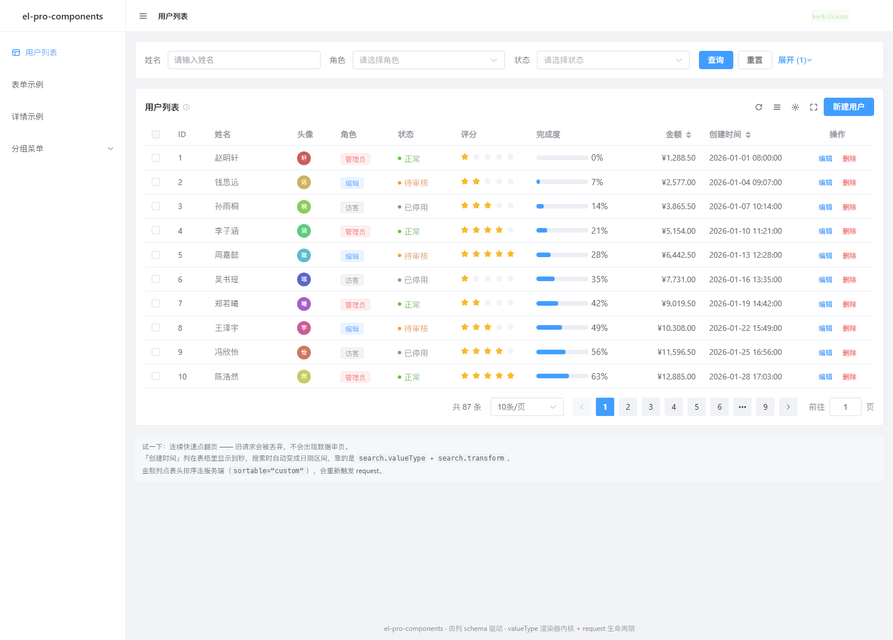
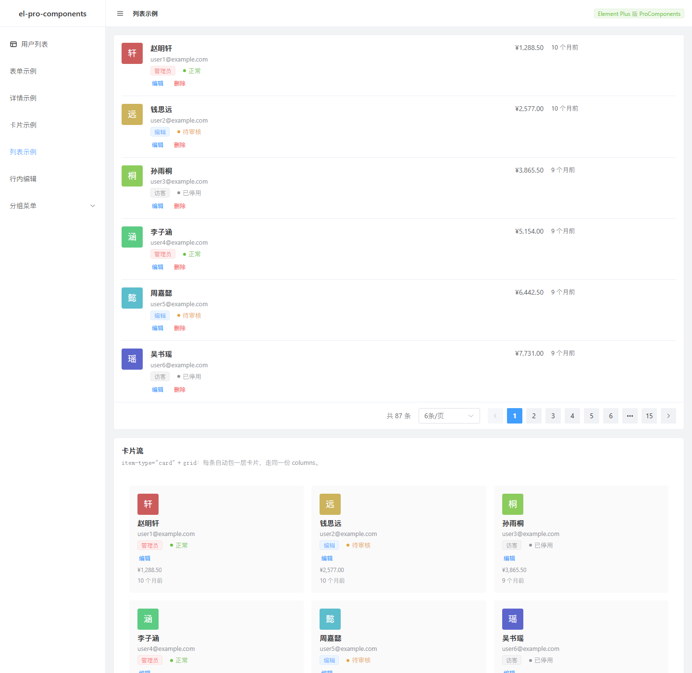
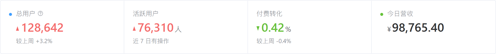

# el-pro-components

Element Plus 体系的 CRUD 高阶组件：**由一份 columns 定义，同时驱动搜索栏、表格列、列设置面板、表单和详情页。**





## 为什么做这个

Element Plus 提供了很好的基础组件，但没有 CRUD 页面的「模板层」。真实项目里每写一个列表页，都要重复做一遍：

- 搜索表单 → 拼参数 → 请求 → 分页 → 排序 → 再请求
- 列的显示/隐藏、密度、刷新按钮
- 表格里把 `status: 1` 翻译成「正常」并染色
- 同一个字段在表格里显示 tag、在详情页里显示同样的 tag、在表单里是下拉

Ant Design 生态用 ProComponents 解决了这个问题，但那是 React 的。Vue 3 + Element Plus 这边没有同量级的对标物。

这个库把那套抽象搬过来，并**按 Element Plus 的习惯重新设计 API**。

## 安装

```bash
npm i el-pro-components
```

```ts
import { createApp } from 'vue'
import ElementPlus from 'element-plus'
import 'element-plus/dist/index.css'
import ElProComponents from 'el-pro-components'
import 'el-pro-components/style.css'

createApp(App).use(ElementPlus).use(ElProComponents).mount('#app')
```

`vue` 和 `element-plus` 是 peerDependencies，不会被打进包里。

## 快速开始

```vue
<script setup lang="ts">
import { ElProTable } from 'el-pro-components'
import type { ProColumn, ProRequest } from 'el-pro-components'

const columns: ProColumn[] = [
  { prop: 'id', label: 'ID', valueType: 'indexBorder', width: 64, search: false },
  { prop: 'name', label: '姓名', copyable: true },
  { prop: 'role', label: '角色', valueType: 'tag', valueEnum: ROLE_ENUM },
  { prop: 'status', label: '状态', valueType: 'status', valueEnum: STATUS_ENUM },
  { prop: 'amount', label: '金额', valueType: 'money', sortable: 'custom', search: false },
  { prop: 'createdAt', label: '创建时间', valueType: 'dateTime', sortable: 'custom' },
  { prop: 'actions', label: '操作', valueType: 'option', fixed: 'right' },
]

const request: ProRequest<User> = async (params, sort, { signal }) => {
  const res = await api.list(params, { signal })
  return { data: res.rows, total: res.total }
}
</script>

<template>
  <ElProTable :columns="columns" :request="request" row-key="id" title="用户列表" selection>
    <template #actions="{ row }">
      <ElButton link type="primary" @click="edit(row)">编辑</ElButton>
    </template>
  </ElProTable>
</template>
```

**就这样。** 搜索栏、分页、排序、列设置、刷新、密度切换、全屏全部自动出现。

## request 的约定

```ts
type ProRequest<T> = (
  params: { current: number; pageSize: number; [key: string]: any },
  sort: Record<string, 'asc' | 'desc'>,
  extra: { signal: AbortSignal },
) => Promise<{ data: T[]; total?: number; success?: boolean }> | T[]
```

三个要点：

1. **`params` 的合并顺序**：搜索表单值 → `params` prop → 分页信息。`params` 优先级高于搜索表单，适合放路由参数这类外部条件。
2. **`sort` 是 `{ 字段: 'asc' | 'desc' }`**，不是 antd 的 `'ascend' | 'descend'`。只有配置了 `sortable="custom"` 的列才会进这里。
3. **竞态已处理**。内部用自增序号丢弃过期响应，所以连续快速切页不会出现数据串页；同时会把 `AbortController.signal` 给你，接进 axios/fetch 就能真正取消请求、省带宽。

后端参数名不一样时，用 `paramsAdapter` 转换，不用改内部约定：

```vue
<ElProTable
  :params-adapter="(p) => ({ pageNum: p.current, limit: p.pageSize, ...p })"
  ...
/>
```

## 组件

| 组件 | 一句话 |
| --- | --- |
| `ElProTable` | 列配置驱动的 CRUD 表格（搜索栏 / 列设置 / 分页 / 排序 / 竞态） |
| `ElProEditableTable` | 上面那个把「行内编辑」预置好的薄壳 |
| `ElProForm` | 同一份 columns 生成表单 |
| `ElProDescriptions` | 同一份 columns 生成详情页 |
| `ElProLayout` | 侧边菜单 + 面包屑外壳 |
| `ElProCard` | 结构化头部 + 折叠 + 嵌套分组 + 标签页 |
| `ElProStatistic` / `ElProStatisticCard` / `ElProStatisticCardGroup` | 指标卡：数值 + 趋势 + 图表位，几张拼一条 |
| `ElProCheckCard` / `ElProCheckCardGroup` | 整块可点的卡片，做单选/多选 |
| `ElProList` | 同一份 columns 生成列表页 / 卡片流 |
| `ElProSkeleton` | 列表 / 表格 / 详情 / 结果页四种版式的骨架屏 |

### ElProTable

| 属性 | 说明 |
| --- | --- |
| `columns` | 列定义，必填 |
| `request` | 数据请求函数 |
| `params` | 额外查询参数，变化自动重查 |
| `search` | 是否显示搜索栏，默认 `true` |
| `options` | 工具栏图标开关 `{ reload, density, setting, fullscreen }`，传 `false` 全关 |
| `selection` | 是否显示多选列 |
| `pagination` | 分页配置，传 `false` 关闭 |
| `persistenceKey` | 传了就把列显隐 / 顺序 / 固定持久化到 localStorage |
| `columnOrder` | 受控列顺序（prop 数组），配合 `v-model:column-order` |
| `columnFixed` | 受控固定列（`{ prop: 'left' \| 'right' }`），配合 `v-model:column-fixed` |
| `paramsAdapter` | 后端参数名转换 |

插槽：`#toolbar`（标题区）、`#toolbarActions`（右侧按钮）、`#batch`（批量操作）、`#empty`、`#${列的 prop}`（列自定义渲染）。

#### 列配置

工具栏的列设置面板（右上角齿轮）做了四件事，状态都跟着 `persistenceKey` 落 localStorage：

| 能力 | 说明 |
| --- | --- |
| 显示 / 隐藏 | 勾选框；`index` / `option` 列和 `hideInSetting` 的列不进面板，避免把自己锁死 |
| 拖拽排序 | 原生 HTML5 拖拽，不引 sortablejs；只重排可设置列，索引列/操作列原地不动 |
| **固定列首 / 列尾** | 每行右侧两个钉住图标，再点一次同一侧即取消 |
| 重置 | 显隐、顺序、固定一起回到 `columns` 的原始定义 |

固定列会**连带重排顺序**：el-table 的 `fixed` 是 sticky + 逐列累加 offset，固定列夹在普通列中间会被盖住。所以按「左固定 → 普通 → 右固定」重排，组内保持原相对顺序（`sortPropsByFixed`），并把新顺序写回 `order`。

面板本体是 `ElProTable/ColumnSetting.vue`，它**只上报用户意图**（勾选 / 拖到哪 / 固定到哪），
三份状态都归 `ElProTable` 所有 —— 面板自己拼新状态会踩 props 快照的坑（同一 tick 连点两次，第二次覆盖第一次）。


通过 ref 拿到的实例方法：

```ts
tableRef.value.reload()          // 刷新，保持当前页
tableRef.value.reloadAndRest()   // 刷新并回到第一页、清空选中
tableRef.value.reset()           // 重置搜索条件 + 排序 + 页码
tableRef.value.clearSelected()
tableRef.value.setPage({ current: 3 })
tableRef.value.getData()         // 当前页数据，可用于导出
```

#### 行内编辑

给 `editable` 就进入编辑态；`ElProEditableTable` 只是把默认值收好的薄壳：

```vue
<ElProTable
  :columns="columns"
  :request="request"
  :editable="{
    type: 'single',                 // single：切换行会先保存当前行；multiple：可同时编辑多行
    onSave: (key, row) => api.save(key, row),
    onDelete: (key) => api.remove(key),
  }"
/>
```

- 单元格用哪个控件由 `valueType` 决定（`money` → 数字框、`role` → 下拉），和表单是同一套渲染器。
- `column.editable` 控制哪一列可编辑：不写按 `valueType` 推断（`index` / `option` / `progress` / `image` 之类不进编辑态），也可以传函数按行决定。
- **保存失败不会丢输入**：`onSave` 返回 `false` 或抛错时，该行留在编辑态、数据不写回。
- 保存前只改草稿，`data` 里的原对象不动 —— 这样「取消」才有意义。
- **新增行拿主键**：`onSave` 可以返回保存后的记录（接口回包），返回的对象会合并进该行。返回了主键，这一行才会摆脱内部临时 key（`__new_n`），之后编辑、删除才能拿真实 id 调接口。
- 新增行没有 id 时用内部临时 key 区分编辑态；临时 key 存在行对象的 `Symbol` 属性上，不会出现在 `JSON.stringify` 或发出去的请求体里。

### ElProForm

```vue
<ElProForm :columns="columns" :model="model" :span="8" label-width="90px" @submit="onSubmit" />
```

`model` 需要传**响应式对象**（`reactive`），组件直接读写它的字段——和 `el-form` 的约定一致。

`rules`、`formItemProps` 直接透传给 `el-form-item`；`fieldProps` 透传给输入控件。
`valueType: 'divider'` 可以插分组标题。

实例方法：`validate()`、`reset()`、`clearValidate()`、`submit()`。

### ElProDescriptions

```vue
<ElProDescriptions :columns="columns" :data="row" :column="3" />
```

和表格共用同一份 columns。表格里显示成 tag 的字段，详情页自动是同一个 tag——不用维护两套字典。`descriptionsSpan` 控制跨列。

详情页通常「一个页面一个接口」，让父级为它维护 `loading` / `error` / `data` 三份状态其实很啰嗦，所以也可以把请求交给组件：

```vue
<ElProDescriptions
  ref="descRef"
  :columns="columns"
  :request="(params, { signal }) => api.detail(params.id, { signal })"
  :params="params"
  :column="{ xs: 1, md: 2, lg: 3 }"
/>
```

| 属性 | 说明 |
| --- | --- |
| `request(params, { signal })` | 返回 `{ data, success?, errorMessage? }`。**必须包一层 `data`**：记录本身是任意对象，允许裸对象的话，记录里恰好有 `data` 字段时就分不清了 |
| `params` | 透传给 request 的参数，引用变化会重新请求。**必须是稳定引用**，模板里写 `:params="{ id }"` 每次渲染都是新对象，会无限重查 |
| `immediate` | 默认 `true`；传 `false` 则挂载后不自动请求，等 `reload()` |
| `loading` | 受控加载态，与内部请求态取或 |
| `column` | 支持响应式：`{ xs: 1, md: 2, lg: 3 }`。窄屏不配这个，三列会把标签挤成一列竖排 |

`request` 模式下：首次加载显示 `descriptions` 版式的骨架屏；`success: false` 时顶部出错误提示但**不清空已展示的记录**（留着旧数据比白屏有用）；切 `params` 会 abort 上一次请求，并用自增 id 丢弃过期回包。

实例方法：`reload()` / `refresh()`，以及 `data`。

### ElProLayout

```vue
<ElProLayout :menus="menus" :active-path="route.path" title="后台管理" @select="onSelect" />
```

只负责「长什么样」，不 import `vue-router`。跳转交给 `el-menu` 的 `router` 模式，或自己监听 `@select`。
面包屑从菜单树自动推导，详情页这类匹配不到菜单的路径会退化为最长前缀匹配。

### ElProCard

```vue
<ElProCard v-model:collapsed="folded" title="基础信息" sub-title="随用随填" tooltip="标题旁的问号" collapsible>
  <template #extra>
    <ElButton link type="primary">更多</ElButton>
  </template>
  内容
</ElProCard>
```

三个关键能力：

1. **嵌套即布局。** 父卡里放子卡时，父卡 body 自动去 padding、子卡自动去边框 —— 外框由父卡统一承担：

```vue
<ElProCard title="分组" split="vertical" :gutter="16">
  <ElProCard title="左" :col-span="12">…</ElProCard>
  <ElProCard title="右" :col-span="12">…</ElProCard>
</ElProCard>
```

`colSpan` 按 24 栅格算（也可以写 `'30%'` / `'320px'`），并按断点响应：
`:col-span="{ xs: 24, lg: 12 }"`。`split` 画分割线，`gutter` 拉间距。

2. **头部可以换成标签页**，省掉「外层 el-tabs + 里面 N 个 el-card」：

```vue
<ElProCard v-model:active-key="tab" :tabs="[{ key: 'a', label: '概览' }]">
  <template #tab-a>…</template>
</ElProCard>
```

3. **一套开关**：`ghost`（只当布局容器）、`hoverable`、`boxShadow`、`bordered`、`type="inner"`、`size="small"`、`loading`、`cover`、`actions`。

### ElProStatistic / ElProStatisticCard

后台首页几乎必有的那块：一个数值 + 标题 + 趋势 + 可选图表。数值和卡片分成两层，所以字号、千分位、趋势配色只有一处实现。

```vue
<ElProStatisticCardGroup :gutter="0">
  <ElProStatisticCard
    v-for="item in overview"
    :key="item.title"
    :col-span="6"
    :statistic="item"
  />
</ElProStatisticCardGroup>
```

`Group` 只做两件事：记住排列方向、把子卡拼成一条画分割线。子卡宽度仍由 `col-span` 决定（24 栅格），所以「四等分」就是 `:col-span="6"`，和 `ElProCard` 的嵌套规则完全一致。

`statistic` 的字段：

| 字段 | 说明 |
| --- | --- |
| `value` / `title` / `tip` / `description` | 数值、标题、标题旁问号、数值下方说明 |
| `precision` | 小数位数。不传则保留原值位数，不做取舍 |
| `prefix` / `suffix` | `¥` / `人` / `%`，字号比数值小一号 |
| `trend` | `up` / `down`。**红涨绿跌**，与源码注释的「中国金融语义」一致；想反过来覆盖 `--el-pro-statistic-trend-up-color` / `-down-color` |
| `status` | 数值前的小圆点：`success` / `processing` / `warning` / `error` / `default` |
| `layout` | `vertical`（默认，标题上数值下）/ `horizontal`（同行，同 14px）/ `inline`（挤一行，13px 次级色） |
| `icon` / `formatter` / `loading` / `groupSeparator` | 左侧图标、完全自定义格式化、占位条、千分位符 |

卡片上还能放图表，`chart-placement` 决定它和数值的相对位置：

```vue
<ElProStatisticCard
  :col-span="12"
  chart-placement="right"
  :statistic="{ title: '磁盘占用', value: 68, suffix: '%' }"
>
  <template #chart>
    <ElProgress type="dashboard" :percentage="68" :width="96" />
  </template>
</ElProStatisticCard>
```

卡片侧的属性（`title` / `tooltip` / `extra` / `bordered` / `loading` / `col-span` / `gutter`）经 `$attrs` 原样透传给 `ElProCard`，两边不重复声明——否则迟早不同步。



### ElProCheckCard

```vue
<ElProCheckCardGroup v-model="plan" :options="planOptions" :column="3" />
<ElProCheckCardGroup v-model="features" multiple>
  <ElProCheckCard value="alert" title="告警通知" description="阈值触发时推送到值班群" />
</ElProCheckCardGroup>
```

单选传值、多选传数组，组件按 `multiple` 自己判断。`disabled` 可以放在组上（整组禁用）或单张卡上。

### ElProList

```vue
<ElProList :columns="columns" :request="request" row-key="id" />
```

`columns` 和表格共用，靠 `listSlot` 决定字段在条目里的角色：

| listSlot | 位置 |
| --- | --- |
| `avatar` | 左侧头像/缩略图 |
| `title` / `subTitle` | 主标题 / 次标题 |
| `description` | 标签行（自动 flex 换行） |
| `content` | 标题下的自由区 |
| `extra` / `aside` | 右侧统计 / 右侧附加说明 |
| `actions` | 操作区（等价于 `valueType: 'option'`） |

不写 `listSlot` 也能跑：`avatar`/`image` 类型自动进头像位，第一个普通列自动当标题。
数据来源二选一 —— 给 `request` 走服务端分页，给 `dataSource` 走本地分页。
`item-type="card"` + `:grid="{ column: 3, gutter: 16 }"` 就是卡片流。

### ElProSkeleton

`type` 取 `list` / `table` / `descriptions` / `grid` / `card` / `result`。`ElProCard` 的 `loading` 内部用的就是它。

`result` 是给结果页（提交成功 / 404 / 无权限）用的：居中圆形图标位 + 标题条 + 说明条 + 两个按钮位。

## valueType 对照表

同一个 `valueType`，在表格/详情里决定**怎么显示**，在搜索栏/表单里决定**用什么控件**。

| valueType | 表格显示 | 表单控件 |
| --- | --- | --- |
| `text` | 纯文本 | ElInput |
| `textarea` / `code` | 纯文本 | ElInput textarea（code 用等宽字体） |
| `password` | 纯文本 | ElInput password |
| `number` | 数字 | ElInputNumber |
| `digitRange` | `10 ~ 50` | 两个 ElInputNumber |
| `money` | ¥1,288.50 | ElInputNumber |
| `percent` | 65.0% | ElInputNumber |
| `second` | 2小时1分钟5秒 | ElInputNumber（单位是秒） |
| `rate` | 星星 | ElRate |
| `slider` | 数字 | ElSlider |
| `select` / `tag` | 枚举文本 / ElTag | ElSelect |
| `status` | 圆点 + 文本 | ElSelect |
| `radio` / `radioButton` | 枚举文本 | ElRadioGroup |
| `checkbox` / `cascader` / `treeSelect` | 值用「、」连接 | 对应控件 |
| `switch` | 是 / 否 | ElSwitch |
| `segmented` | 枚举文本 | ElSegmented |
| `date` / `dateTime` | 格式化日期 | ElDatePicker |
| `dateRange` / `dateTimeRange` | `a ~ b` | 带 range 的 DatePicker |
| `time` / `timeRange` | HH:mm:ss | ElTimePicker |
| `dateWeek` | 2026 第 45 周 | week picker |
| `dateMonth` / `dateYear` | YYYY-MM / YYYY | month / year picker |
| `dateQuarter` | YYYY-Q4 | ⚠️ 降级为 month picker（见已知限制） |
| `fromNow` | 10 个月前 | — |
| `progress` | 进度条 | — |
| `image` / `avatar` | 缩略图 / 圆形头像 | — |
| `color` | 色块 | ElColorPicker |
| `index` / `indexBorder` | 行号 | — |
| `option` | 操作列（配合插槽） | — |

`valueEnum` 是字典，string 或对象都能写：

```ts
const STATUS_ENUM = {
  active: { text: '正常', status: 'success' },   // status 映射到 el-tag 的 type
  pending: { text: '待审核', status: 'warning' },
  disabled: { text: '已停用', status: 'info' },
}
```

> 没写 `valueType` 但配了 `valueEnum` 时，按 `select` / `tag` 语义处理——和 ProComponents 的行为一致。

## 一个常见场景：表格显示到秒、搜索用日期区间

```ts
{
  prop: 'createdAt',
  label: '创建时间',
  valueType: 'dateTime',        // 表格里显示 2026-01-01 08:00:00
  search: {
    valueType: 'dateRange',     // 搜索时换成区间选择器
    span: 8,
    transform: (v) =>           // 把 [开始, 结束] 转成后端要的两个字段
      v?.length === 2 ? { startTime: v[0], endTime: v[1] } : {},
  },
}
```

## 从 ProComponents 迁移

API 是**按 Element Plus 习惯**设计的，所以不能直接复制粘贴 antd 的例子。改动集中在这几处：

| ProComponents | 这里 | 说明 |
| --- | --- | --- |
| `title`（列） | `label` | 沿用 el-table-column |
| `sorter: true` = 服务端排序 | `sortable="custom"` | **语义相反**。el-table 里裸 `sortable` 是本地排序，加 `custom` 才是服务端 |
| `ellipsis` | `showOverflowTooltip` | |
| `filters + onFilter` | `filters + filterMethod` | |
| `initialValue` | `defaultValue` | 搜索项初始值 |
| `fieldProps` | `fieldProps` | 同名 |
| `request(params, sort, filter)` | `request(params, sort, { signal })` | 第三参换成取消信号 |
| `'ascend' \| 'descend'` | `'asc' \| 'desc'` | |
| `actionRef.current.reload()` | `ref.value.reload()` | |
| `search={{ collapsed }}` | `defaultCollapsed` | |

## 已知限制

诚实列出来。这里只放**客观上做不到**的；「还没做」的都在 Roadmap 里，别混在一起——混了会让读者误判优先级。

- **`dateQuarter` / `dateQuarterRange` 表单里降级为月选择器。** Element Plus 没有季度选择器。展示没问题（能正确算出 `2026-Q4`），但选不了季度。需要的话传 `fieldComponent` 自定义。
- **`ElProCard` 的 `split` 与 `wrap` 混用不保证好看。** 一行塞多个不同 `colSpan` 又换行时，分割线按 DOM 顺序画，可能出现「行首也带线」。
- **表格没有多级表头。** `columns` 是扁平数组，`el-table-column` 的嵌套写法没有对应入口；顺带也就没法声明 `type="expand"` 的展开行。已经排在 Roadmap 第一位。
- **列设置不支持分组列。** 上一条的衍生：没有嵌套结构，就没有「分组拖拽」可做。

## 踩过的坑（改这块之前先看）

- **`el-table` 的 `data` 是深度响应式的。** 它内部 `const _data = ref([])`，所以插槽里拿到的 `row` 是原始行对象的 **Proxy**。
  后果：`data.indexOf(row)` 永远 -1，`r !== row` 永远成立，`WeakMap` 按引用存 key 也永远命中不了。
  需要行标识就**认字段**（`row[rowKey]`），新增行没有 id 时把临时 key 写在行对象上（本项目用 `Symbol` 键，不进 JSON）。

## Roadmap

- [x] 列设置里拖拽调整列顺序
- [x] 列设置里固定列首 / 列尾
- [x] `ElProEditableTable`（行内编辑）
- [x] `ElProCard` / `ElProCheckCard` / `ElProList` / `ElProSkeleton`
- [x] `ElProStatistic` / `ElProStatisticCard`（含 `Group`）
- [x] `ElProDescriptions` 支持 `request` 与响应式 `column`
- [x] `Skeleton` 的 `result` 版式，`second` / `digitRange` 两个 valueType
- [ ] **表格多级表头 + 默认插槽**（列设置分组、展开行都卡在这）
- [ ] 表单布局变体：`StepsForm` / `ModalForm` / `DrawerForm`
- [ ] 表单分组 `group` 与列表型字段 `formList` / 字段联动 `dependency`
- [ ] `QueryFilter`（表格页顶部独立的筛选区）
- [ ] 列设置分组（嵌套表头 + 分组拖拽）
- [ ] 导出当前列定义对应的 CSV
- [ ] 行拖拽排序（`sortablejs` 可选依赖）

## 开发

```bash
npm install
npm run dev         # playground，默认 http://127.0.0.1:5273
npm run build       # 打包库产物到 dist/
npm run typecheck   # 类型检查
```

playground 支持 `?page=/users`、`/form`、`/detail`、`/card`、`/list`、`/editable` 直接打开对应页面。

demo 本身也按「壳 / 页 / 数据」拆开了，加一个示例只动 `pages/` 一个文件：

```
demo/
├── App.vue                    # 布局壳 + 路由分支，不含任何示例业务
├── menu.ts                    # 侧边菜单 + ?page= 解析
├── data/
│   ├── enums.ts               # 角色 / 状态字典
│   └── mock.ts                # User 类型、87 条假数据、requestUsers、delay
├── composables/
│   └── useUserEditor.ts       # 「编辑谁、弹窗开没开」这类页面级状态
├── components/
│   └── UserEditDialog.vue     # 新建 / 编辑弹窗（用户页和列表页共用）
└── pages/
    ├── UsersPage.vue          # 列配置驱动的 CRUD 主场景
    ├── FormPage.vue
    ├── DetailPage.vue
    ├── CardPage.vue
    ├── ListPage.vue
    ├── EditablePage.vue
    └── PlaceholderPage.vue    # 未实现的菜单项
```

## 目录结构

```
src/
├── core/
│   ├── valueType.ts    # 格式化内核：值 → 文本/tag/进度，不 import 任何组件
│   ├── useTable.ts     # 请求生命周期：分页/排序/搜索合并 + 竞态
│   ├── column.ts       # 列的「可设置 / 可排序」判定与顺序应用
│   ├── responsive.ts   # 断点订阅 + 响应式取值（colSpan / gutter / grid）
│   └── cardContext.ts  # 卡片父子关系的 provide/inject 契约
├── fields/
│   ├── CellRenderer.vue  # 展示侧外壳（读）
│   └── FormField.vue     # 输入侧外壳（写）
├── components/
│   ├── ElProTable/       # ElProTable + ElProEditableTable + SearchForm + TableToolbar + ColumnSetting
│   ├── ElProForm/
│   ├── ElProDescriptions/
│   ├── ElProLayout/
│   ├── ElProCard/        # ElProCard / ElProCheckCard / ElProCheckCardGroup
│   ├── ElProList/
│   └── ElProSkeleton/
└── types.ts
```

`core/` 完全不依赖组件，所以格式化规则可以被表格、详情页、导出逻辑共用。
`fields/` 是读和写两种外壳，共用同一套 valueType 词汇——这是整个库最核心的分层。

## License

MIT
